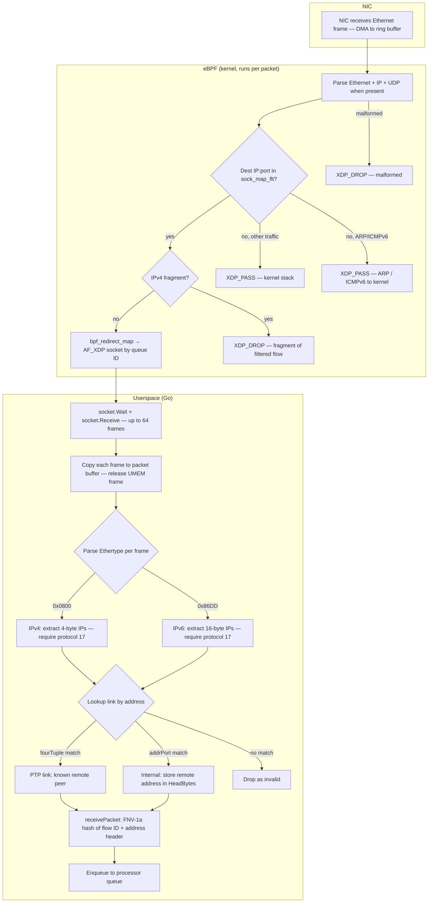
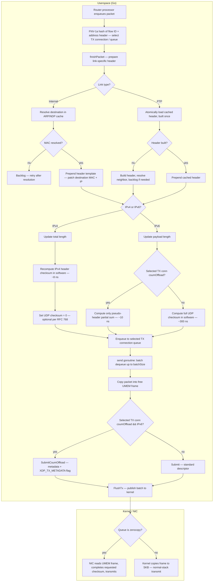
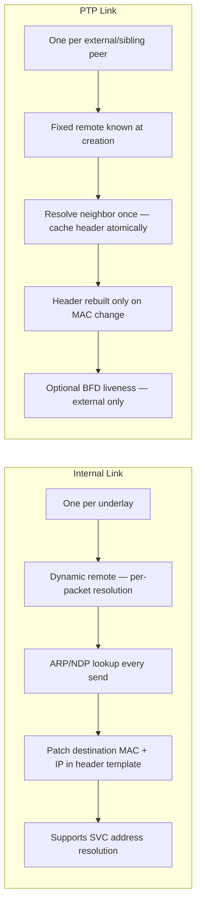

# afxdpudpip — AF_XDP UDP/IP Underlay

This SCION router underlay carries SCION packets wrapped in Ethernet/IP/UDP over raw AF_XDP
sockets. It uses `XDP_ZEROCOPY` where supported and otherwise falls back to copy mode. On
zerocopy queues, it also enables IPv6 UDP checksum offload when the kernel and driver
advertise AF_XDP `tx-checksum`.

The underlay is opt-in. Set `router.preferred_underlays.udpip` to `"afxdp"`. The default is
`inet`. See [doc/manuals/router.rst](../../../doc/manuals/router.rst).

## Scope and Limitations

This underlay targets the common SCION use case, with these constraints:

- **No IP fragmentation.** On TX, IPv4 sets DF per
  [RFC 791 §3.1](https://www.rfc-editor.org/rfc/rfc791#section-3.1), and IPv6 emits no Fragment
  extension header per [RFC 8200 §4.5](https://www.rfc-editor.org/rfc/rfc8200#section-4.5). On
  RX, only the first IPv4 fragment contains the UDP header, so only it reliably matches an
  AF_XDP filter. XDP drops a matching first fragment (`MF=1`); later fragments have a nonzero
  offset, usually pass to the kernel, and are discarded when reassembly times out. IPv6
  fragments take the non-UDP branch because `NextHeader=44`; the kernel receives and discards
  them because no socket is bound to the relevant ports. Thus, no fragments reach the SCION
  router's userspace RX path. The path MTU comes from SCION path metadata, so a fragment
  indicates a misconfigured peer or non-conforming sender.
- **MTU is limited by the configured UMEM `frame_size`.** The default supports Ethernet MTU
  1500; jumbo frames are unsupported. See *AF_XDP Per-Link Options* in
  [doc/manuals/router.rst](../../../doc/manuals/router.rst) for tuning options.

For other L2 transports for IP/UDP, use the `inet` udpip underlay.

## Packet Lifecycle

### RX Path

### TX Path

### Internal vs PTP Links

## Checksum Offload

- IPv4 TX never uses AF_XDP checksum offload. Software always recomputes the IPv4 header
  checksum and leaves the UDP checksum zero.
- IPv6 TX uses checksum offload when the selected TX connection has `csumOffload=true`.
  Userspace writes the IPv6 UDP pseudo-header seed and submits AF_XDP TX metadata. The NIC,
  which cannot see the pseudo-header fields, sums the UDP header and payload to finish the
  checksum.
- `csumOffload=true` requires all of the following:
  1. The kernel accepts UMEM TX metadata registration (`XDP_UMEM_TX_METADATA_LEN`).
  2. The bound AF_XDP queue uses zerocopy mode.
  3. The netdevice advertises AF_XDP `xsk-features: tx-checksum` through the `netdev`
     generic-netlink family.
- If any check fails, IPv6 uses a full software UDP checksum instead of emitting a seed that
  the queue would not complete.
- The decision is per selected TX connection, not per link. A multi-queue link can safely mix
  queues with different capabilities.
- UMEM may reserve TX metadata headroom even when offload is disabled. This keeps descriptor
  addressing consistent and does not imply offload is active.

## Metrics

XDP-dropped packets bypass userspace and its normal RX counters. The XDP program maintains
kernel-side counters, while AF_XDP sockets expose drop/error statistics. Separate Prometheus
metric families publish each source. On every scrape, userspace reads the eBPF map and calls
`getsockopt(XDP_STATISTICS)` once per socket; the forwarding path reads neither.

- `router_xdp_drops_total{nic, reason}` — `XDP_DROP` counts from the `drop_counters`
  `PERCPU_ARRAY` in [sockfilter.c](../../../private/underlay/ebpf/sockfilter.c).
  Reasons: `eth_malformed`, `ip_malformed`, `udp_malformed`, `fragment`.
- `router_afxdp_socket_drops_total{nic, queue, stat}` —
  `getsockopt(SOL_XDP, XDP_STATISTICS)`, where `stat` is `rx_dropped`, `rx_invalid_descs`,
  `tx_invalid_descs`, `rx_ring_full`, `rx_fill_ring_empty_descs`, or `tx_ring_empty_descs`.

Only the drop path touches `drop_counters`. The eBPF program increments the current CPU's
slot; userspace sums the per-CPU slots into one value on each scrape.

The C `DROP_REASON_*` indices must match Go's `ebpf.DropReasonNames`. `NewInterface` fails if
`drop_counters.MaxEntries != len(DropReasonNames)`.

## Test Validation

- `testdata/*.bin` contains golden Ethernet/IP/UDP frames captured from the Linux stack on a
  veth pair. Before commit, kernel-variable fields are normalized to the fixed canonical
  values emitted by this implementation, keeping the files deterministic across runs.
- Package tests compare the output of `finishPacket` with those frames byte-for-byte. They
  also compare output from the lower-level builders in `internal/headers` and
  `internal/checksum`.
- The golden files validate finalized software-checksum packets. A separate unit test verifies
  that the IPv6 checksum-offload path in `finishPacket` writes the expected pseudo-header
  seed.
- Maintainers explicitly regenerate golden files with
  `go run ./router/underlayproviders/afxdpudpip/cmd/packetgolden`; CI does not require this.
